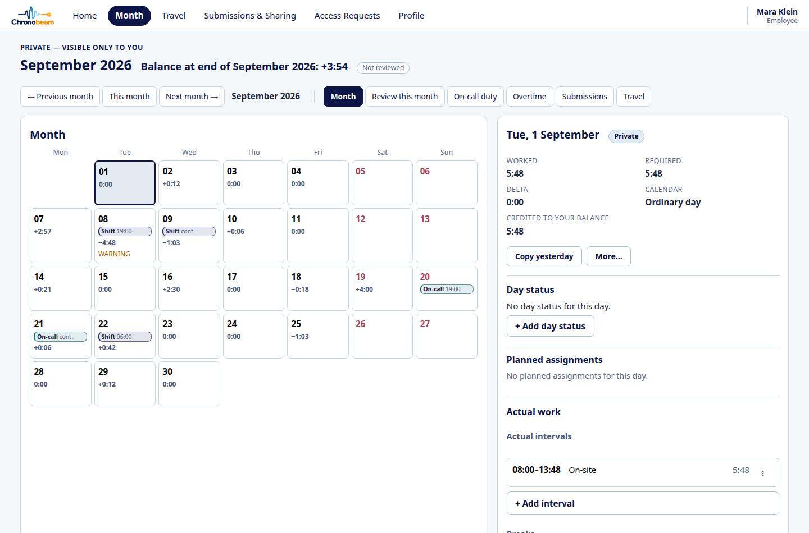
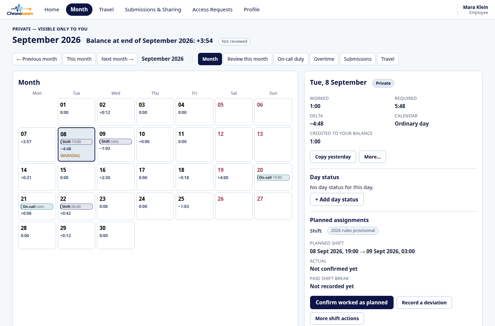
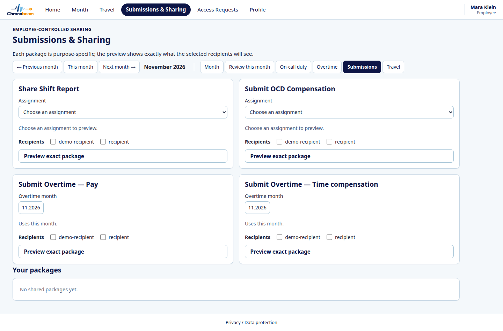
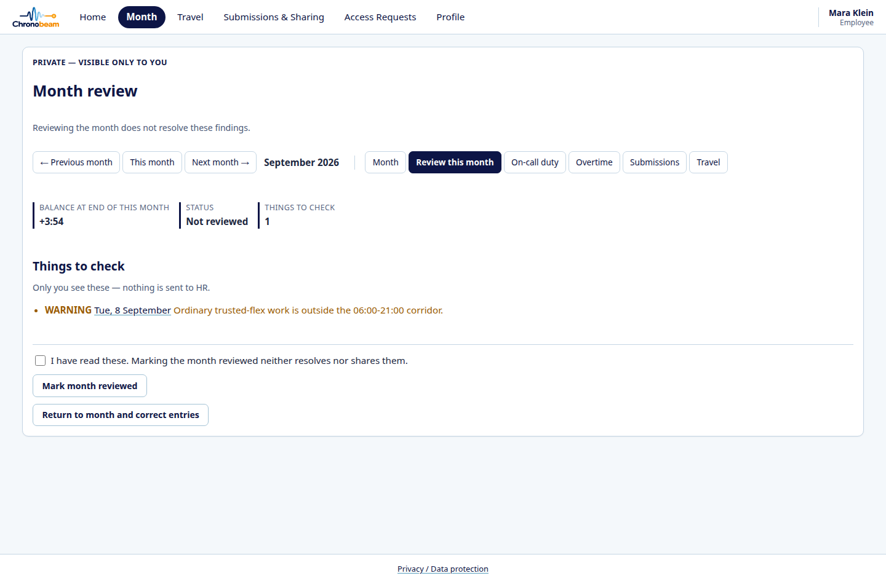
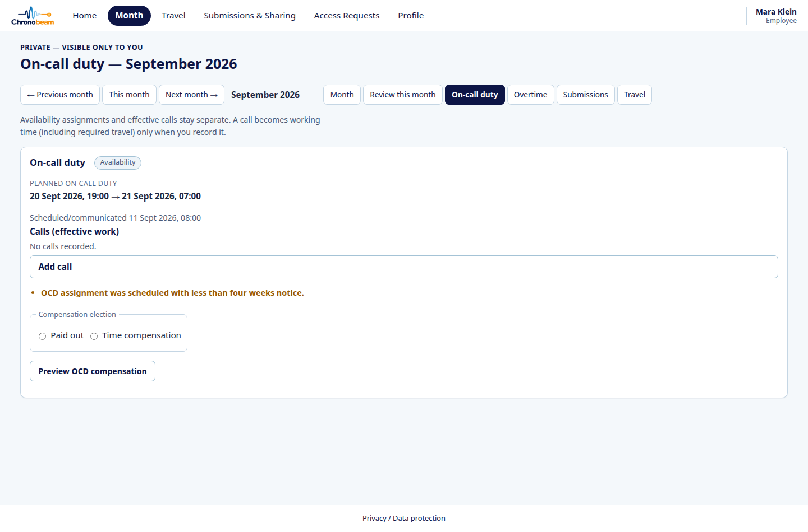
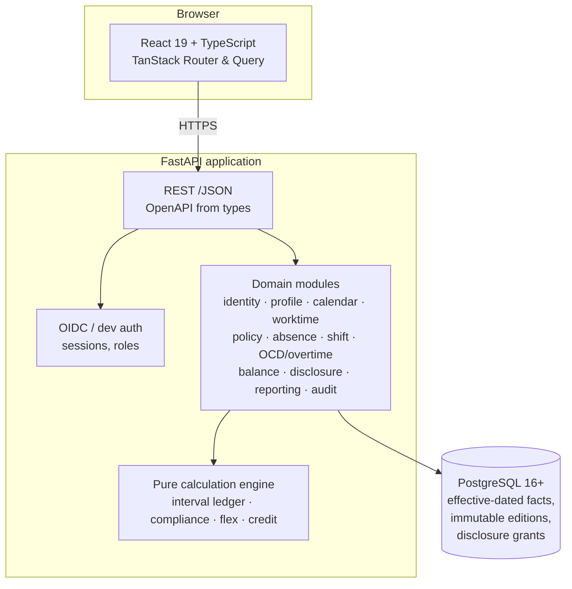

<p align="center">
  
</p>

# Chronobeam

Chronobeam is a working-time service for shift-based and on-call organisations in Germany. Employees record
actual work as timestamped intervals, see the resulting balances and compliance findings in
private, and disclose a purpose-limited projection to HR, a supervisor, payroll or the Works
Council only when they choose to.

It is a complete vertical slice: FastAPI and PostgreSQL on the server, React and TypeScript in the
browser, real migrations, real authorization tests, and a deterministic synthetic demo.

**This repository is source-available for inspection and portfolio evaluation. It is not open
source.** See [License](#license).

---

## Scope: Germany

Chronobeam is built for the German legal and operational context, and it is not jurisdiction
neutral:

- **Working-time law is German.** The compliance rules implement the Arbeitszeitgesetz (ArbZG):
  the ten-hour daily maximum, the 30- and 45-minute breaks in segments of at least 15 minutes,
  the six-hour uninterrupted limit, and the eleven-hour rest period. The eight-hour day is the
  statutory default the ten-hour extension is measured against, and the six-month or 24-week
  averaging it depends on is **not** computed here; see
  [known limitations](docs/KNOWN_LIMITATIONS.md).
- **Time is German civil time.** Business timezone is `Europe/Berlin`, instants are stored in
  `timestamptz`, and daylight-saving gaps and overlaps are detected rather than guessed.
- **Public holidays are Land competence.** The shipped calendar derives the statutory holidays of
  one federal state from its own statute; a deployment in another Land supplies its own day set
  through the ordinary calendar-publication path and changes no code.
- **Absence vocabulary is German practice.** Vacation, sickness, compensation days and
  employer-free days are first-class day-status categories, and the external HR absence system is
  the workflow owner for them.
- **Foreign working-time law is not modelled.** Work recorded abroad is measured against the
  German thresholds like any other work, because the ledger has no jurisdiction field. The engine
  states explicitly that it does not assess a host country's own rules (`TRAVEL-LOCAL-001`).

A deployment outside Germany would replace the statutory rule set, the calendar and the
configurable policy parameters. The domain model, the interval ledger and the disclosure model
are not country specific.

---

## What it does

| Workflow | What the employee can do |
|---|---|
| **Time recording** | Record zero to many work intervals per day, including intervals that cross midnight. Mixed on-site and remote work on the same day. Explicit breaks. |
| **Compliance** | See the statutory checks the law requires: daily maximum, rest between working periods, breaks, uninterrupted blocks. Warnings are for the employee and are never sent to HR automatically. |
| **Flex account** | A running balance from effective-dated contract and schedule data, with configurable warning thresholds and a year-end settlement boundary. |
| **Shift work** | A plan and the actual work stay separate objects. Confirm as planned, record a deviation, or cancel with notice. Overruns are banded. |
| **On-call duty** | Availability assignments and actual call-outs are separate. A call-out produces the work facts, the rest check and the compensation projection. |
| **Overtime** | Authorisation is recorded by an authorised writer, and prior authorisation is checked per interval. |
| **Travel** | Business-trip segments classified as active work, driving or passive travel, with the monthly non-chargeable threshold and a credit projection. |
| **Absence** | Day status from the external HR absence system affects required time, and never silently overwrites recorded work. |
| **Disclosure** | The employee opens a specific view for a specific recipient and purpose. Grants are scoped, and a random-check request reveals no time data until the employee opens the requested view. |
| **Correction** | Unsubmitted facts are editable. Facts already inside a submission keep lineage through supersession instead of being overwritten. |

## Screens

All screens below are the synthetic demo data shipped with `just demo-seed`. No real employee
record appears anywhere in this repository.

| | |
|---|---|
| **Month ledger.** Interval facts, per-day delta, shift and on-call markers, and the balance, all private to the employee. |  |
| **Day detail.** Required versus worked, calendar class, day status, planned assignments and the actual intervals. |  |
| **Employee-controlled sharing.** Each purpose gets its own package and its own recipient list. |  |
| **Month review.** Findings are the employee's own; marking a month reviewed neither resolves nor shares them. |  |
| **On-call duty.** Availability, call-outs and the compensation projection. |  |

## Architecture



The calculation engine is pure: it takes facts and a frozen parameter set and returns a result.
It performs no lookup and reads no clock, so a period can be recomputed years later and produce
the same numbers.

| Layer | Choice |
|---|---|
| Backend | Python 3.12, FastAPI, Pydantic v2, SQLAlchemy 2, Alembic |
| Database | PostgreSQL 16 or newer |
| Frontend | React, TypeScript, Vite, TanStack Router and Query |
| Tests | pytest and Hypothesis, Vitest, a small Playwright suite |
| Packaging | Docker image, Compose for local development, `just` as the task runner |

## Engineering highlights

**Interval ledger, not a daily total.** Actual work is a set of timestamped intervals, so a night
shift crossing midnight is one fact, not two. Durations are computed from elapsed instants rather
than wall-clock subtraction, and a DST-ambiguous or non-existent local time is rejected instead of
guessed.

**Policy editions that cannot be rewritten.** A rule set's parameters are frozen, typed code. Its
identity, effective dates and provenance are database rows. Resolution fails closed: an unknown
edition raises instead of falling back to the newest one, so a historical month can never be
silently restated under today's rules. The shipped-history allowlist is append-only, and a
corrected parameter set is a new edition with a new effective date.

**Privacy as a domain rule.** HR, supervisors and technical administrators have no standing access
to the ledger. A disclosure is a projection computed for one recipient, purpose and scope, not a
flag on a row. The random-check flow is the sharpest case: the request creates no readable data,
and the employee must review and open the requested view before anything is exposed. Each of those
boundaries has a targeted authorization test.

**Planned versus actual.** A planned shift, the actual work and a deviation are three objects. A
cancellation keeps the plan as the compensation basis and leaves the actual facts alone; a
retraction of a mistaken plan is a different act with different consequences.

**Concurrency where the invariants live.** Every writer of one employee's facts takes a single
per-employee lock before reading current-version or overlap state, which makes the
`max(version) + 1` read-then-write sequences mutually exclusive without a table-level lock. A
session commits before the response is sent, so a `2xx` never acknowledges a write that then fails.

## Quickstart

Prerequisites: Docker, [`uv`](https://docs.astral.sh/uv/), Node.js 22 with Corepack, and `just`.

The development database image is `postgres:18-alpine`. The backup CLI and the `just ci` backup
proof shell out to the host's `pg_dump`/`pg_restore`, so install client tools at least as new as
that image's major version; the CLI refuses a mismatched pairing and names the fix
([docs/backup_restore.md](docs/backup_restore.md)).

```bash
just bootstrap     # tool check, database, dependencies, migrations, synthetic dev data
just dev           # backend on 127.0.0.1:8000, frontend on 127.0.0.1:5173
```

Configuration is documented in [.env.example](.env.example) and
[docs/CONFIGURATION.md](docs/CONFIGURATION.md). Development authentication is a per-request
principal header that is refused when the application runs in production mode; production expects
an OIDC provider.

### Demo

```bash
just demo          # six isolated persona origins and the servers, against demo-seeded data
just demo-open tabs
just demo-down
```

`just demo` seeds 14 synthetic personas into the local database: full-time and part-time
employees, a shift worker, an on-call duty holder, a traveller, a technical administrator, an HR
random-check requester and a submission recipient. Six of them get their own origin, so six
identities can be shown side by side in one browser window without sharing a session. All names
and addresses are synthetic and use the reserved `.invalid` domain.

The demo seed owns the whole database and refuses to build on top of the ordinary development
seed. If you already ran `just bootstrap`, run `just demo-reseed` first. That is destructive: it
drops the local development volume and re-creates the schema. Use a separate database or a
separate checkout if you need to keep both.

## Tests

```bash
just check          # lint, format, typecheck, dependency architecture, API contract, unit tests
just ci             # the above plus migration checks against a real database
just e2e            # Playwright journeys
```

```bash
just test-backend   # pytest + Hypothesis
just test-frontend  # Vitest
just migration-check
just api-check
```

Backend integration tests need PostgreSQL and skip when it is absent. Set
`CHRONOBEAM_REQUIRE_DB=1` to make an unavailable database a failure rather than a skip. See
[docs/TESTING.md](docs/TESTING.md) for the command map and the limits of the browser suite.

The authorization suite is the part worth reading. It asserts, among other things:

```text
HR reads an employee month without a grant        -> denied
Supervisor reads by hierarchy alone               -> denied
HR creates a random-check request                 -> no time data exposed
Employee opens the requested view                 -> only the requested scope
HR requests the adjacent month                    -> denied
Share shift report                                -> shift projection only
Submit OCD compensation                           -> OCD projection only
Employee-only warning detected                    -> no automatic HR visibility
```

## Policy basis

Every executable rule is mapped to a public German statute (or to an explicitly non-binding sample
policy). There is no third category, and nothing here derives from a confidential document.

- `LAW-*` rules cite the German Working Time Act, the Federal Leave Act, data-protection law and
  EU Directive 2003/88/EC, with the section and an authoritative link.
- `POL-*` rules are sample configuration for the demonstration: shift limits, on-call remuneration,
  allowance percentages, travel credit and the flex corridor. They are labelled as such in the code
  and in the UI.

See [docs/POLICY_SOURCES.md](docs/POLICY_SOURCES.md) and
[docs/RULE_CATALOGUE.md](docs/RULE_CATALOGUE.md).

## Security boundaries

The application owns authentication, sessions, authorization, disclosure, correction lineage and
logging. TLS termination, database transport protection, encryption at rest, secret storage,
backups, monitoring and rate limiting are deployment responsibilities and are not implemented here.
The threat model, the authorization model and what the tests cover are in
[docs/SECURITY.md](docs/SECURITY.md) and
[docs/security/THREAT_MODEL.md](docs/security/THREAT_MODEL.md).

## Known limitations

Enterprise integrations (an HR absence interface, a shift-plan source, an OCD schedule, payroll)
are adapter boundaries with test doubles, not live connections. Several sample-policy parameters
are deliberately left undecided, so the corresponding rules capture facts and refuse to produce a
verdict. Both are listed in [docs/KNOWN_LIMITATIONS.md](docs/KNOWN_LIMITATIONS.md).

## License

Copyright (c) 2026 Dmitrii S. Bespalov. All rights reserved.

This source code is publicly available for inspection and portfolio evaluation. Except as
permitted by applicable law and the hosting platform's terms, no permission is granted to use,
reproduce, modify, distribute, sublicense, deploy, or incorporate this software into another
product or service without prior written authorization from the copyright holder.

Commercial licensing, institutional deployment, custom implementation, integration and
maintenance can be arranged under a separate written agreement. The full notice is in
[LICENSE.md](LICENSE.md).

## Contact

The maintainer is [@SpookyPike](https://github.com/SpookyPike) on GitHub. No email address is
published; GitHub is the contact channel.

- **Licensing, deployment, integration or custom development:** open an issue using the
  [licensing inquiry](.github/ISSUE_TEMPLATE/licensing-inquiry.md) template. A short description of
  the organisation, the workflows you care about and any integration context is enough to start.
- **Questions about the code or the design:** open a regular issue on this repository.
- **Security reports:** use this repository's private vulnerability reporting (Security tab,
  "Report a vulnerability") and do not open a public issue. See
  [docs/SECURITY.md](docs/SECURITY.md).

Third-party components keep their own licenses; see [NOTICE.md](NOTICE.md).