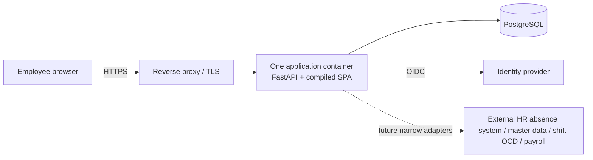

# Architecture

This document describes the application boundary and data flow in this repository. It does not
describe a deployed system. Source references link to the implementation; the canonical rule
inventory and policy mechanics remain in their own documents:
[RULE_CATALOGUE.md](RULE_CATALOGUE.md) and [POLICY_CONFIGURATION.md](POLICY_CONFIGURATION.md).

## Runtime topology

The application serves the compiled frontend when its configured distribution directory exists;
the same FastAPI app mounts `/assets` and falls back to the SPA entry point for browser navigation.
Production disables OpenAPI, Swagger UI and ReDoc. The proxy and its TLS termination are outside the
application container. The application trusts forwarded headers only from the configured proxy
networks. PostgreSQL is the only primary persistence system. [Application construction and
mounts](../backend/app/main.py#L47-L69), [static SPA serving](../backend/app/static.py#L10-L44),
[route and middleware registration](../backend/app/main.py#L74-L171).

The browser uses the frontend router/query client and a central API client. Requests reach the
FastAPI route, server-side identity/ownership/capability dependencies, and a domain service or pure
calculation function. Services use synchronous SQLAlchemy sessions against PostgreSQL. Not every
domain uses a calculation engine: identity/admin, disclosure, calendar publication, cutover and
reporting also have direct service/transaction paths. [Frontend router](../frontend/src/router.tsx#L1-L20),
[API client](../frontend/src/lib/api.ts#L1-L89), [mounted domain routes](../backend/app/main.py#L245-L267).

## Application and domain map

| Area | Responsibility |
|---|---|
| Identity and profile | Map authenticated subjects to active employees; roles and effective-dated employee schedules/contracts. |
| Calendar | Effective-dated holiday and employer-free-day classifications; covered dates are required for authoritative month calculations. |
| Worktime and absence | Actual interval/break facts and employee-owned day-status facts; absence status does not replace actual work. |
| Policy and balance | Versioned deterministic working-time calculations and derived balances. |
| Shift, OCD/overtime and travel | Separate plans, assignments, actual work/calls, deviations, authorization/election facts and travel segments. |
| Disclosure and reporting | Employee-opened scoped views and purpose-specific frozen submission projections. |
| Integrations, audit and administration | Narrow adapter seams, limited accountability events, and technical/user lifecycle operations. |

Representative live paths include `/health/live`, `/api/v1/auth/login`, `/api/v1/me`,
`/api/v1/me/months/{year_month}`, `/api/v1/me/work-intervals`, `/api/v1/hr/access-requests`,
`/api/v1/me/submissions/{purpose}` and `/api/v1/admin/system`. The app also retains a `/health`
compatibility alias. The app includes health, auth, identity, day-status, worktime, policy, shift,
OCD/overtime, disclosure, cutover, onboarding, reporting, travel and admin routers. Exact
registration is in [main.py](../backend/app/main.py#L245-L267); representative employee worktime
routes are in [worktime/routes.py](../backend/app/worktime/routes.py#L81-L126) and disclosure routes
in [disclosure/routes.py](../backend/app/disclosure/routes.py#L71-L116).

## Four accounting layers

The system keeps four distinct questions separate: (1) actual worked time, (2) required working
time, (3) qualifying balance credit, and (4) payable or compensable allowance. The same interval can
therefore appear in multiple calculations without one amount being substituted for another. The
policy engine owns deterministic working-time results; travel, shift and OCD modules retain their
own facts and domain calculations. The stable rule IDs, statuses and descriptions are in the
[rule catalogue](RULE_CATALOGUE.md), not repeated here.

Ordinary and travel parameters are frozen in code-owned typed editions. A database `PolicyVersion`
provides identity, version, effective dates, status and provenance; the edition registry provides
the immutable parameter set keyed by the engine rule-set name. Resolution selects the version
covering the accounting month. Missing/unregistered editions fail closed with a policy blocked
response. Calendar coverage is also effective-dated; uncovered periods return a calendar
unavailable response rather than assuming ordinary workdays. See
[policy configuration](POLICY_CONFIGURATION.md) for the mechanics and selected values.

## Identity, transactions and history

Production identity enters through OIDC. The application validates discovery/JWKS metadata and
authorization-code PKCE state, nonce and browser binding, then maps the subject to a pre-existing
active employee. Capabilities derive from the mapped employee and server-side role assignments,
not identity-provider role claims. Application administration permits user lifecycle and system
status; it does not grant work-ledger access. Development/test principal headers and static-key
seams are not production authentication paths. [OIDC flow](../backend/app/auth/oidc.py#L35-L70),
[principal and capabilities](../backend/app/auth/deps.py#L62-L83),
[dev/test principal boundary](../backend/app/auth/deps.py#L128-L165).

Production sessions use opaque hashed tokens in `__Host-` Secure, HttpOnly, SameSite=Lax cookies.
Mutation requests use the CSRF middleware. Idle and absolute expiry are enforced. [Session cookie
and expiry](../backend/app/auth/session_service.py#L14-L67), [CSRF
middleware](../backend/app/main.py#L80-L130).

The request-scoped database dependency owns commit, rollback and close. A shared app-level
function-scoped dependency commits before the response is sent, so a successful mutation response
means its transaction has crossed the durability boundary. Employee-fact mutations coordinate on
an employee advisory lock; calendar publication/review uses a calendar coordination lock. When
both are required, calendar lock precedes employee lock. Identity and bootstrap locks serve
separate operations. [Session lifecycle and commit boundary](../backend/app/db.py#L44-L105),
[lock namespaces and order](../backend/app/db.py#L108-L161).

Intervals and breaks use versions, `supersedes_id`, one-successor uniqueness and correction
records. A correction supplies the expected version; an already submitted or disclosed fact is
not destructively overwritten. Disclosure packages freeze minimized JSON projections and retain
recipient and policy-version references. Grants bind the recipient, purpose, period, view and
expiry/revocation state. [Versioned worktime records](../backend/app/worktime/models.py#L62-L80),
[correction routes](../backend/app/worktime/routes.py#L181-L216), [disclosure grant and package
models](../backend/app/disclosure/models.py#L85-L150), [package creation](../backend/app/disclosure/service.py#L541-L589).

## Privacy and disclosure boundaries

Detailed work facts and employee findings are private by default. A random-check request contains
no ledger facts; the employee reviews/corrects and opens the requested one-month view before a
scoped grant is made. Submission actions expose their purpose-specific projection, not the monthly
ledger. Technical administration and organizational hierarchy do not create a ledger reader.
The [threat model](security/THREAT_MODEL.md) describes the control inventory and remaining
deployment responsibilities, and [SECURITY.md](SECURITY.md) summarizes the authorization model.

Audit is a limited accountability model with an allowlist of scalar metadata; routine GET reads are
not generally audited. Application request logs use matched route templates, and Uvicorn access logs
replace raw request targets with a fixed marker so path identifiers are not emitted. Logs redact
credentials and personal request content and return generic error responses with a request ID. These
code controls do not establish proxy, identity-provider or platform logging behavior. [Audit
allowlist](../backend/app/audit/models.py#L39-L73), [log
redaction](../backend/app/logging_conf.py#L18-L97), [generic error
response](../backend/app/main.py#L136-L148).

## Integration and cutover boundary

The real external HR absence system, authoritative master-data, shift/OCD, payroll and identity
provider connections are not established by this repository. Employee-entered plans are not
upstream feeds. Any future adapter must use a documented contract and remain narrow and idempotent.
The external HR absence system remains an absence/day-status source; imported status must not erase
employee actual work.

Normal adoption is a clean month-boundary cutover. Historical employee workbooks remain in the
archive; the service has no historical workbook upload path. The opening state is an auditable
one-time `CUTOVER_SEED` balance/credit, with employee self-service also available. The plan and
actual ledger remain separate. [Cutover implementation](../backend/app/cutover/__init__.py#L1-L4),
[self-service opening state](../backend/app/cutover/self_service.py#L63-L80).