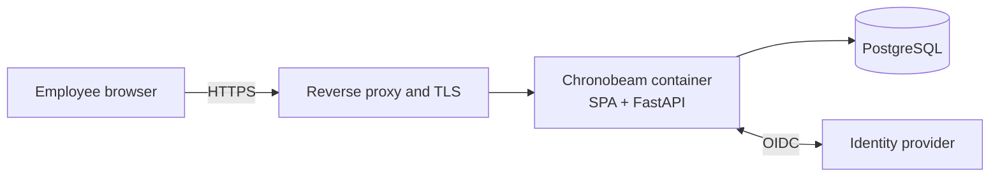

# Security

Chronobeam stores detailed employee working-time facts. The design goal is that those facts stay
private to the employee unless the employee explicitly shares a bounded view. This page summarizes
the trust boundaries, the authorization model, what the tests cover, and how to report a problem.
It does not claim an external audit, certification or production approval.

## Trust boundaries

The application owns its own behavior: authentication, session handling, authorization,
disclosure, correction lineage and logging. The reverse proxy and TLS, database transport
protection, encryption at rest, key management, secret storage, backups, monitoring and rate
limiting are deployment responsibilities and are not provided by this repository. The full control
inventory is in [security/THREAT_MODEL.md](security/THREAT_MODEL.md).

## Authorization model

The employee owns their ledger. The model is deliberately asymmetric:

- **Employee.** Full read and write access to their own work intervals, day status, plans,
  submissions and findings. Corrections preserve lineage instead of overwriting submitted facts.
- **HR, supervisor, Works Council, Payroll.** In code and configuration the Works Council
  recipient is abbreviated `WoCo`; the two mean the same role. No standing ledger access. Neither organizational
  hierarchy nor a role name creates a ledger reader. A supervisor has no special path at all.
- **Technical administrator.** Can manage accounts and system state. That role grants no work-ledger
  access.
- **Random check.** An HR random-check request carries **no time data**. The employee reviews and
  corrects the requested record and then explicitly opens the requested one-month view. Only that
  step produces a grant.
- **Grants.** A grant is recipient-, purpose-, period- and view-bound, and a later grant for the
  same scope supersedes it. The recipient reads the frozen projection captured at grant time, not
  the live ledger. Expiry is enforced when a grant carries one, but this build always creates
  grants with `expires_at` unset: no retention period is guessed. There is no employee-facing
  revoke action; revocation is the operator's, and supersession is the normal path.
- **Submissions.** `Share Shift Report`, `Submit Overtime` and `Submit OCD Compensation` expose a
  purpose-specific projection. They never expose the unrelated monthly ledger, and employee-only
  findings are excluded from the recipient payload.
- **Denial shape.** A resource the caller may not see is indistinguishable from one that does not
  exist, so denials do not confirm the existence of other employees' data.

Session and transport controls that carry this model: OIDC authorization-code flow with PKCE,
state, nonce and browser binding; opaque hashed session tokens in `__Host-` Secure, HttpOnly,
SameSite=Lax cookies with idle and absolute expiry; and an Origin/CSRF check on mutating requests.
Capabilities are derived server-side from the mapped employee and role assignments, never from
identity-provider claims.

## What the tests cover

The backend suite contains targeted deny/allow cases for these boundaries, including
`test_ACCESS_002_hr_reads_employee_month_without_grant_denied`,
`test_ACCESS_007_hr_request_create_reveals_no_ledger_data`,
`test_ACCESS_009_scope_only_requested_month`,
`test_ACCESS_009_grantee_only_and_adjacent_read_denied`, and the cross-employee IDOR cases in
`test_authz_db.py`. They are source-level tests: they prove the routes behave as specified when the
suite is run, not that a deployed instance is configured correctly. Run them as described in
[TESTING.md](TESTING.md).

## Reporting a vulnerability

Report privately through the repository's private security-reporting channel (for example a
GitHub security advisory on the hosting repository) rather than a public issue. Include the affected
route or file, the impact, the conditions needed to reproduce it, and the commit you tested. Do not
include real employee data, production database contents or credentials in a report; use synthetic
data.

There is no bug-bounty programme and no guaranteed response time. Confirmed issues are fixed in the
public history unless a report needs coordinated disclosure.