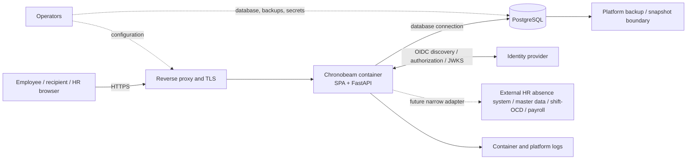

# Security threat model

This document describes application controls visible in source and the responsibilities that
remain outside the application. **IMPLEMENTED** means source behavior is present; it does not mean
the control was verified in a test artifact. No check artifact is cited here, so this document
makes no “verified” claim.

## Data flow and trust boundaries

Trust boundaries are the browser-to-edge connection; edge-to-container forwarding; app-to-identity
provider protocol; app-to-database transport; database/backup administration; operator access; and
development/CI handling. Only the application-side behavior is described as implemented below.
Approved TLS edge, network policy, database transport protection, platform encryption at rest, key
management, secret storage, backup protection and operational monitoring remain deployment
responsibilities and are not established by local code.

## Data and recipients

The application can hold employee identity and profile/schedule data, actual work intervals and
breaks, day-status/absence facts, shift and OCD plans/calls, travel facts, derived calculation
snapshots, disclosure grants and packages, and limited audit events. A `SICK` day-status is
sensitive employment data because it can reveal health information; the model minimizes the
representation and does not store medical detail or an absence comment.

The employee is the default recipient of their detailed ledger and findings. HR/Works Council/
Payroll recipients receive only explicit scoped grants or purpose-specific packages. Technical
administrators can manage accounts/system state but do not receive ledger access through that
role. Operator and database privileges are not established here. Future upstream adapters are
absent unless separately documented.

Residual inference: per-day `required_minutes` can reveal that a half-day reduction occurred,
including a sickness-related status. This is a known inference channel even when the underlying
day-status label is not disclosed.

## Control inventory

| Threat/control | Status and evidence |
|---|---|
| OIDC discovery/JWKS substitution or insecure endpoint | **IMPLEMENTED** — HTTPS discovery/endpoints, discovery issuer match, JWKS cache and one refresh for an unknown key ID. This is protocol code, not a live identity-provider connection. [oidc.py](../../backend/app/auth/oidc.py#L35-L70) |
| Login CSRF/replay or token substitution | **IMPLEMENTED** — S256 PKCE; persisted single-use state, verifier, nonce and browser binding; callback consumes state under lock and validates nonce. [OIDC start](../../backend/app/auth/oidc.py#L153-L173), [callback](../../backend/app/auth/routes.py#L86-L97), [state consumption](../../backend/app/auth/routes.py#L139-L166) |
| Unsupported client authentication | **IMPLEMENTED** — only `none`, `basic` and `post`; `private_key_jwt` is unsupported. [config validator](../../backend/app/config.py#L162-L169), [client auth](../../backend/app/auth/oidc.py#L184-L202) |
| Stolen or stale browser session | **IMPLEMENTED** — `__Host-` Secure, HttpOnly, SameSite=Lax, Path `/` cookie; opaque token stored hashed; idle/absolute expiry; active employee and subject binding checked. [cookie](../../backend/app/auth/session_service.py#L14-L31), [session checks](../../backend/app/auth/session_service.py#L45-L67), [request binding](../../backend/app/auth/routes.py#L116-L124) |
| Cross-site mutation | **IMPLEMENTED** — production mutation middleware checks Origin against configured public base URL when Origin is present and checks the session CSRF token when a cookie session exists. Login callback is excluded. [CSRF middleware](../../backend/app/main.py#L80-L130) |
| HR/supervisor/admin access to employee ledger | **IMPLEMENTED** — capabilities derive from active mapped employee and server roles; no supervisor role or broad HR/admin ledger reader. [capability derivation](../../backend/app/auth/deps.py#L62-L83), [roles](../../backend/app/auth/roles.py#L11-L22), [principal](../../backend/app/auth/principal.py#L13-L27) |
| Random-check request exposes data before employee action | **IMPLEMENTED** — request contains no ledger; employee explicitly opens requested one-month view before grant/snapshot. [request route](../../backend/app/disclosure/routes.py#L72-L77), [request model/service](../../backend/app/disclosure/service.py#L177-L203), [open view](../../backend/app/disclosure/service.py#L380-L395) |
| Grant overbroad, stale or misdirected | **IMPLEMENTED** — recipient, purpose, period, view, expiry, revocation and supersession are checked; only frozen projection is returned. [grant model](../../backend/app/disclosure/models.py#L85-L123), [read check](../../backend/app/disclosure/service.py#L541-L589) |
| Submission leaks unrelated ledger or private findings | **IMPLEMENTED** — employee-confirmed purpose projection is frozen; findings are excluded from recipient payload. [projection construction](../../backend/app/disclosure/service.py#L821-L849), [package model](../../backend/app/disclosure/models.py#L141-L150) |
| Log/error disclosure | **IMPLEMENTED** — application request logs use matched route templates; unmatched routes use a fixed marker; Uvicorn access logs replace raw request targets. Redaction covers bearer/dev headers, passwords, cookies/CSRF and DSNs; exception messages are withheld; generic errors carry request IDs. This does not establish proxy/identity-provider/platform log behavior. [redaction](../../backend/app/logging_conf.py#L18-L97), [request logging](../../backend/app/main.py#L136-L174) |
| Audit payload includes comments or arbitrary data | **IMPLEMENTED** — fixed scalar metadata allowlist rejects unknown keys; no request body/payload. [audit allowlist](../../backend/app/audit/models.py#L39-L73) |
| Dev/test identity seam used in production | **IMPLEMENTED** — development header principal is only used outside production; production requires cookie session and startup defaults to production. [environment default](../../backend/app/config.py#L39-L41), [principal dependency](../../backend/app/auth/deps.py#L128-L165) |
| Dependency/container provenance | **IMPLEMENTED** — lock-based `uv`/`pnpm` installs, pinned base-image digests and runtime UID/GID 10001. `apt-get upgrade` means rebuilt image bytes are not deterministic. [Dockerfile](../../Dockerfile#L1-L19), [runtime user/build](../../Dockerfile#L37-L48) |
| Edge TLS, host routing, rate limiting and monitoring | **DEPLOYMENT CONFIGURATION** — the edge must provide approved TLS/host policy and rate controls; there is no in-app rate limiter. Production configuration does not itself prove the edge is configured. |
| Database transport, at-rest encryption, backup/snapshot encryption and key management | **DEPLOYMENT CONFIGURATION** — required platform controls, not established by application source. |
| Secret delivery and operator privilege | **DEPLOYMENT CONFIGURATION** — credential values belong in approved secret storage; the store and operator role separation are deployment-owned. |
| Legal basis, data inventory, retention/deletion, notice and impact assessment | **OWNED OUTSIDE THIS REPOSITORY** — no outcome, legal basis or retention period is asserted here. |
| Live identity provider and external HR absence/master-data/shift-OCD/payroll feeds | **FUTURE** — interfaces are not established. Employee-entered plans are not upstream feeds. |

## Data integrity and recovery

Interval/break correction uses version lineage rather than destructive replacement; submitted
facts and recipient packages are frozen with policy/version references. Transactions commit before
successful mutation responses, and employee/calendar operations use explicit coordination locks.
These controls support integrity but do not establish backup recovery for a real deployment.
[Correction chain](../../backend/app/worktime/models.py#L62-L80), [durability
boundary](../../backend/app/db.py#L77-L105), [lock ordering](../../backend/app/db.py#L108-L161),
[package snapshots](../../backend/app/disclosure/models.py#L126-L150).

Application controls and deployment controls need separate evidence; a source citation is not a
verification artifact. See [SECURITY.md](../SECURITY.md) for the authorization model and for what
the test suite covers.